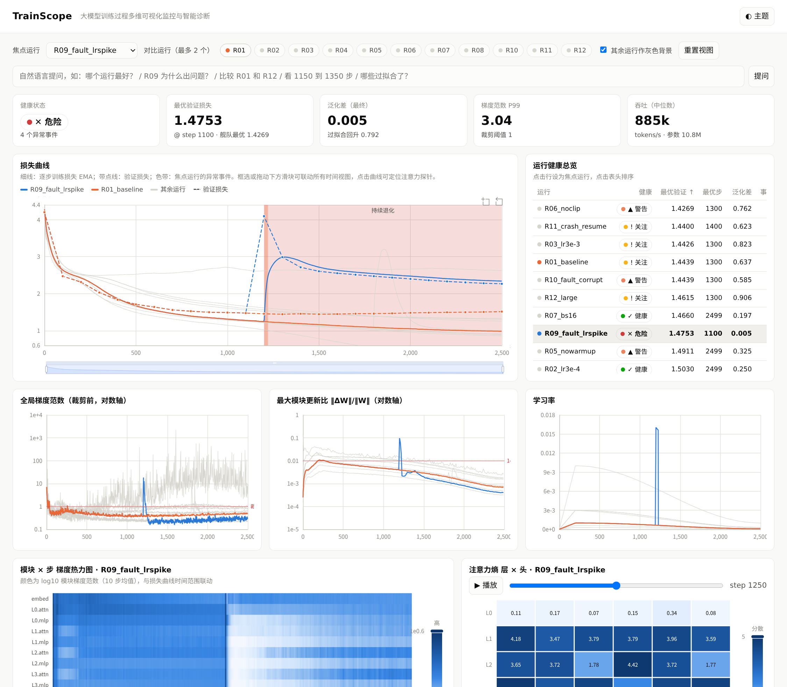

# TrainScope

**面向大模型训练过程的多维可视化监控与多智能体诊断系统**
（《数据可视化与智能交互》课程期末项目 · 杜禹衡 23307130324）

仓库：https://github.com/RowanDVega/computer-visualization-final

TrainScope 在真实的 GPT 训练过程中植入探针，采集逐步、逐模块、逐注意力头的多维指标，
经过清洗、特征工程和降维之后，用一个联动的交互式仪表盘呈现出来。
系统还用"规划 → 监控 → 诊断 → 建议 → 报告"多智能体工作流自动定位训练异常并给出处置建议。



## 特性

- **真实数据**：在 TinyShakespeare 上训练 12 组字符级 GPT（10.8M / 25.4M 参数），覆盖学习率扫描、
  无预热、无裁剪、小批量、无 dropout、扩容，以及**学习率尖峰注入**、**标签污染注入**、**崩溃-断点续训**三类真实故障。
- **数据处理**：非有限值解析、续训重复步去重、计时污染剔除、EMA/滚动中位数平滑、稳健 z 分数；
  14 维模块梯度做 PCA 训练轨迹，384 维字符嵌入做 t-SNE（numpy 自实现，无 sklearn 依赖）。
- **可视化**：损失 / 梯度 / 更新比 / 学习率四个时间视图联动缩放，模块×步梯度热力图，
  层×头注意力熵（可播放），PCA 轨迹，超参数平行坐标，嵌入投影，数据质量表；
  采用 focus+context 配色（焦点运行彩色、其余灰色），并支持明暗双主题。
- **智能体**：9 类可解释检测器，加上取证工具和根因知识库（softmax 置信度），处置建议附带具体步数；
  所有消息都记录在执行轨迹里，可以回放。设置 `ANTHROPIC_API_KEY` 后，Reporter 会用 LLM 对报告做证据约束润色。
- **自然语言交互**：提问"R09 为什么出问题？""看 1150 到 1350 步""比较 R01 和 R12"，系统会直接执行对应的视图操作。

## 快速开始

```bash
pip install -r requirements.txt
./run_all.sh                 # 训练 12 组（单卡 4090 约 30 分钟）+ 全部分析
SKIP_TRAIN=1 ./run_all.sh    # 已有 data/runs 时仅重跑分析
# 浏览器打开 web/index.html（纯静态，无需服务器）
```

URL 参数：`?focus=R05_nowarmup&cmp=R01_baseline&zoom=300,1500&theme=dark&q=R09为什么出问题`

## 目录

```
trainscope/train.py       带探针的 GPT 训练（故障注入、断点续训）
trainscope/preprocess.py  清洗、特征工程、PCA / t-SNE
trainscope/anomaly.py     9 类异常检测器与事件级评估
trainscope/agent.py       多智能体诊断工作流
trainscope/figures.py     论文静态图
trainscope/dashboard.py   导出仪表盘数据
web/index.html            交互式仪表盘（ECharts）
data/runs/                原始 JSONL 日志
data/processed/           清洗结果、摘要、事件、智能体输出
paper/                    论文源文件（HTML → PDF）
```

## 许可

MIT
